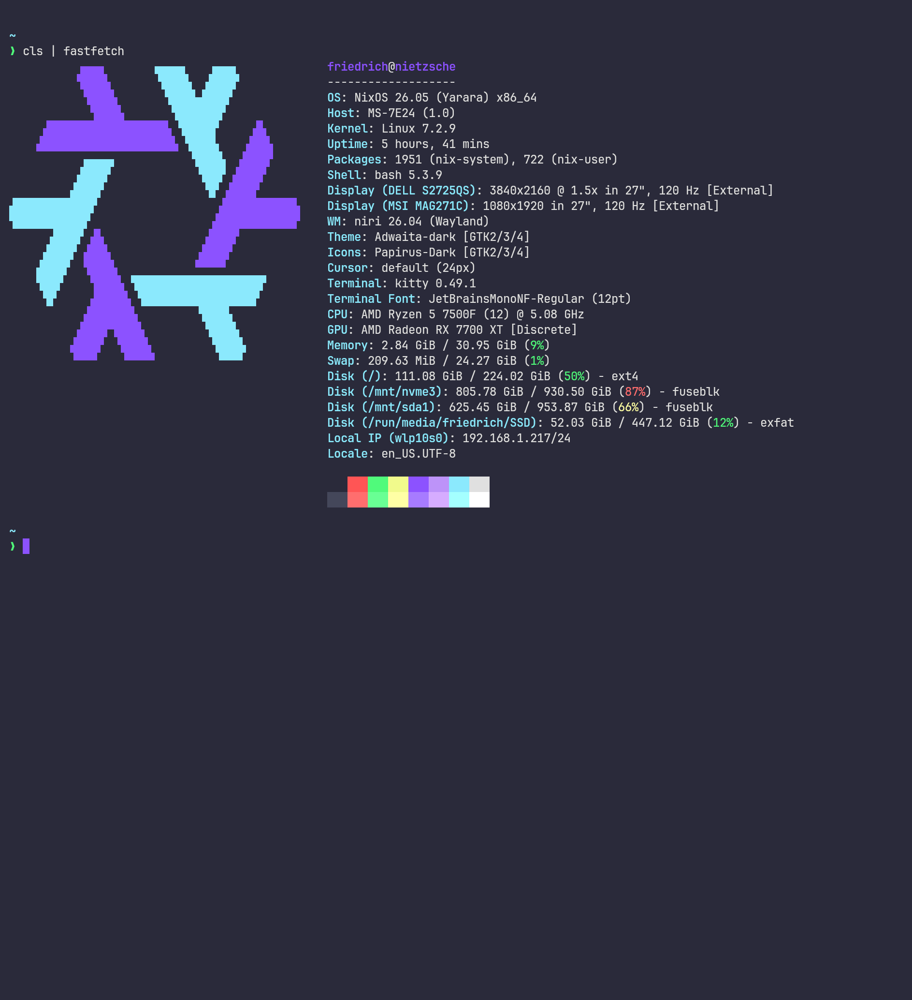
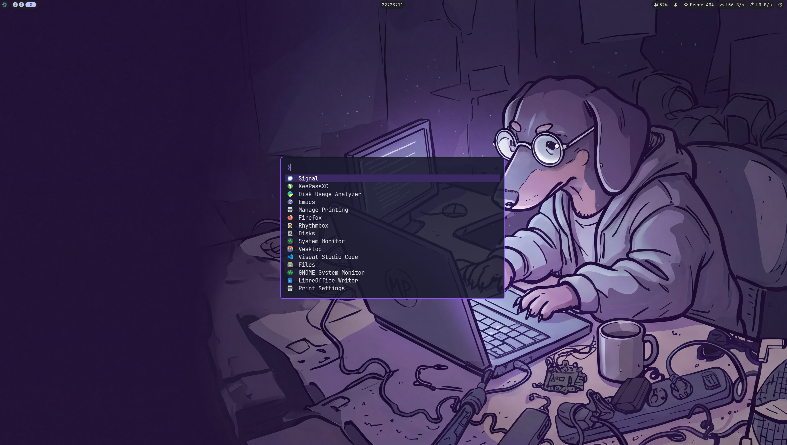
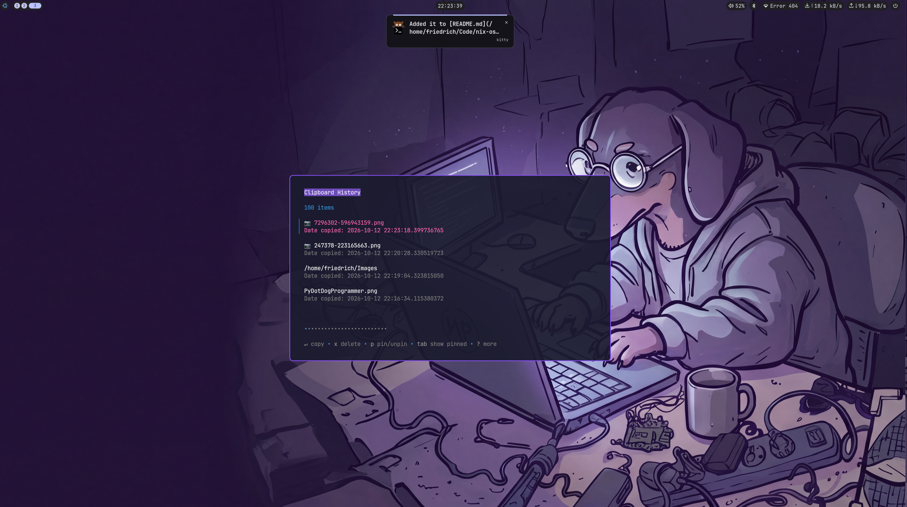

# nix-os-configuration

NixOS flake for the host `nietzsche` (x86_64, AMD RX 7700 XT): a Niri Wayland
desktop with the Noctalia shell, managed together with Home Manager for the
user `friedrich`.

## Screenshots

Kitty terminal with the dark navy and purple palette.



Fuzzel application launcher (`Mod+Space` or `Mod+R`), with the static wallpaper
and Noctalia bar showing workspaces and system controls.



Clipse clipboard history (`Mod+V`) for copied text and images, with controls
to copy, delete, and pin entries.



## Stack

| Input | Purpose |
|-------|---------|
| `nixpkgs` (nixos-26.05) | Base system |
| `nixpkgs-unstable` | Newer apps, passed to modules as `pkgs-unstable` |
| `home-manager` (release-26.05) | User configuration |
| `niri` (sodiboo/niri-flake) | Niri compositor, with Home Manager settings |
| `noctalia-shell` | Status bar, notifications, launcher |
| `nix-doom-emacs-unstraightened` | Doom Emacs built from `modules/home/doom.d` |

## Layout

```
flake.nix                    # Inputs and the nixosConfigurations.nietzsche output
configuration.nix            # Boot, kernel, nix settings, locale, fonts, users
hardware-configuration.nix   # Generated by nixos-generate-config
modules/software/            # System-level NixOS modules
  ai.nix                     #   Ollama (Vulkan), Codex, Claude Code
  common.nix                 #   nh, terminal-exec, shell aliases
  development.nix            #   git, CLI tools, JetBrains IDEs
  creative_software.nix      #   GIMP, Shotcut, OBS, mpv
  niri.nix                   #   Niri, Wayland env vars, XDG portals
  gdm-wallpaper.nix          #   Patches the GDM theme to show the wallpaper
  other.nix                  #   Desktop apps (Firefox, Thunderbird, LibreOffice, ...)
modules/home/                # Home Manager modules (entry: default.nix)
  niri-*.nix                 #   Keybinds, appearance, outputs, static wallpaper
  noctalia.nix, fuzzel.nix, kitty.nix, starship.nix, clipboard.nix
  gtk-qt-theme.nix           #   Dark Adwaita + Papirus theme
  emacs.nix, doom.d/         #   Doom Emacs and the emacs daemon
static-files/                # Desktop and login wallpapers, screenshots, original video
```

## Usage

The system builds from `/etc/nixos`. The `Makefile` copies this repo there
(with rsync `--delete`, so anything in `/etc/nixos` not in the repo is removed)
and runs `nixos-rebuild`.

```sh
nix-shell        # provides make, git, rsync and prints the targets
make help        # list all targets
make build       # build from the repo without touching the system
make diff        # preview what `install` would change in /etc/nixos
make switch      # install, activate and set as boot default
make test        # install and activate without a boot entry
make update      # update flake.lock
make rollback    # go back to the previous generation
```

Once installed, the `nixswitch` / `nixtest` / `nixboot` aliases (via `nh`)
rebuild from `/etc/nixos` directly.

## Monitors

The Dell S2725QS runs at 3840×2160/120 Hz with 1.5× scaling. The MSI MAG271C
runs at 1920×1080/120 Hz, rotated 90°, with 1× scaling. Both modes were
confirmed with `niri msg outputs`; the MSI also advertises 144.001 Hz.
Equal refresh rates do not lock the monitors' physical scanout clocks together.
VRR is left disabled for a stable desktop baseline.

The desktop wallpaper uses awww to display
`static-files/wallpaper.png`, bundled into the Nix store at build time.
Noctalia uses a fixed purple palette. GTK 2/3/4 and Qt 5/6 use purple accents,
with violet Papirus folder icons. Qt uses Fusion with a custom dark palette.
Restart applications after switching; log out/in for the Qt platform setting.
Apps with their own theme engines may need their own theme settings.
Notifications and volume/brightness OSDs appear only on `HDMI-A-1`; music and
control panels opened from the bar also use that screen.

## Performance checks

The boot menu waits one second. Hold Space during boot to open the menu for
an older generation. Store deduplication runs weekly with idle CPU and I/O
priority instead of doing work on each store import. Disk usage can grow
between runs; the persistent timer catches up after missed runs.

The measured baseline was 30.073 seconds to boot, including 11.192 seconds
in firmware, 5.497 in the loader and 8.379 in userspace. These changes have
not yet been benchmarked after reboot. Keep network readiness enabled:
Ollama model downloads and firmware refresh depend on it.

Validate the working tree, including untracked wallpaper files, with:

```sh
nix eval path:.#nixosConfigurations.nietzsche.config.system.build.toplevel.drvPath --raw
nix flake check path:. --no-write-lock-file --no-build
```

The first command materializes Doom Emacs's build-time evaluation input.
Stage new assets before using the normal Git-backed `make build`/`make check`.
After activation and reboot, compare `systemd-analyze` and
`systemd-analyze --user blame`, and check both scopes with `systemctl --failed`
and `systemctl --user --failed`. Noctalia crashes recorded in the baseline
journal remain a separate issue; these changes do not establish their cause.

Niri uses the stable package from the locked NixOS input (currently 26.04),
instead of niri-flake's older 25.08 default. The frame-completion workaround
is retained, and direct scanout is restricted to matching buffer formats to
avoid bandwidth changes. This can reduce direct-scanout opportunities.
These are mitigations for intermittent white lines, not a confirmed hardware fix.
This Niri release does not provide HDR output.

After `make switch`, save your work and log out/in to start the new compositor.
Check `niri --version` and `niri msg outputs`, then reproduce the Signal/browser
workload on both monitors. If flashes persist, temporarily stop the
wallpaper with `systemctl --user stop awww`; restart it with
`systemctl --user start awww` after comparing. Check logs with:

```sh
journalctl --user -b -u niri --no-pager -g 'ERROR|WARN'
journalctl -b -k --no-pager -g 'amdgpu|drm|timeout'
```

The diagnostic session recorded AMD display-buffer timeouts, MSI HDMI hotplug
events, and GLES texture upload errors. Unexpected hotplug events require
checking the cable, port and monitor power settings; configuration alone cannot
repair a physical link. Keep HDR off in the Dell menu while testing SDR output.

## Using on another machine

Regenerate `hardware-configuration.nix` with `nixos-generate-config`, and
change the hostname (`networking.hostName`, `nixosConfigurations.<name>` in
`flake.nix`, `HOST` in the `Makefile`) and the username/git identity where they
appear.
